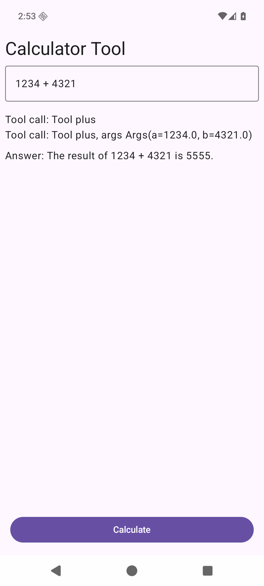
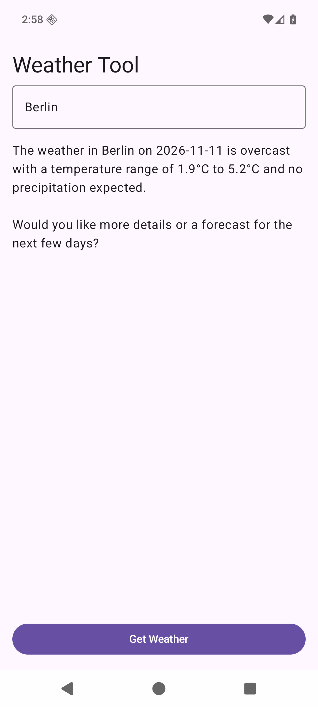

<Card title="View Source Code" icon="github" href="https://github.com/Liquid4All/cookbook/tree/main/examples/android-koog-agent">
  Browse the complete, runnable Android example in the cookbook
</Card>

This tutorial runs [LFM3-1.7B](/lfm/models/lfm3-1.7b) inside an Android app with llama.cpp. [Koog](https://docs.koog.ai) manages the agent and executes tools. A local `LLMClient` passes prompts and tool definitions to the model through llama.cpp's Android JNI library. The calculator works without a network connection; the weather tool fetches a live forecast from Open-Meteo.

The complete app is in [`examples/android-koog-agent`](https://github.com/Liquid4All/cookbook/tree/main/examples/android-koog-agent). It includes the Compose UI, Koog agents, native inference library, and pinned llama.cpp submodule.

## Requirements

- Android Studio, Android SDK 36, CMake 3.31.6, and stable NDK 28.2.13676358
- JDK 17
- An Android 13 (API 33) or later device or emulator with at least 4 GB of RAM recommended
- Space for the approximately 1.1 GB `LFM3-1.7B-Q4_K_M.gguf` model file

The app's llama.cpp binding uses LFM3's recommended general-purpose sampling settings: temperature `0.1`, top-k `50`, and repeat penalty `1.1`. The model can emit `<think>` content; the app removes that block from the answer shown to the user.

## Build and run

1. Clone the cookbook with its pinned llama.cpp submodule:

   ```bash
   git clone --recurse-submodules https://github.com/Liquid4All/cookbook.git
   cd cookbook/examples/android-koog-agent
   ```

2. Build the debug APK:

   ```bash
   ./gradlew :app:assembleDebug
   ```

3. Open `examples/android-koog-agent` in Android Studio and run it on your device or emulator. You can also install the built APK with `adb install app/build/outputs/apk/debug/app-debug.apk`.

4. Download [`LFM3-1.7B-Q4_K_M.gguf`](https://huggingface.co/LiquidAI/LFM3-1.7B-GGUF/blob/main/LFM3-1.7B-Q4_K_M.gguf) to the device. On the app's **Available Tools** screen, tap **Import LFM3-1.7B GGUF** and select that file. The app copies it into its private storage. Wait for **Model ready** before running an agent.

<Note>
The first model import can take a minute. The first agent request also loads the model into memory. No API key or model server is needed.
</Note>

## How the app connects Koog to llama.cpp

The app declares calculator tools in Koog's `ToolRegistry` and gives Koog a local prompt executor:

```kotlin
val localExecutor = SingleLLMPromptExecutor(LocalLfmClient)
val toolRegistry = ToolRegistry {
    tool(CalculatorTools.PlusTool)
    tool(CalculatorTools.MinusTool)
    tool(CalculatorTools.DivideTool)
    tool(CalculatorTools.MultiplyTool)
}
```

[`LocalLfmClient`](https://github.com/Liquid4All/cookbook/blob/main/examples/android-koog-agent/app/src/main/kotlin/ai/liquid/androidkoogagent/agents/common/LocalLfmClient.kt) implements Koog's `LLMClient`. For each agent step, it formats the system prompt and tool definitions, calls the in-process [llama.cpp Android inference engine](/deployment/on-device/llama-cpp/mobile), and turns LFM3 tool-call markup into Koog `Message.Tool.Call` objects. Koog executes the Kotlin tool and supplies its result on the next step. The native library and model stay in the app process.

The weather agent allows consecutive tool calls, so it can request a date and then a forecast. Only its Open-Meteo data request needs internet access. The calculator's tools run entirely on device.

For the general tool-call format and model support, see [Function Calling](/deployment/on-device/llama-cpp/function-calling).

## Verified results

The cookbook app was built and run on an API 36 ARM64 Pixel 8 emulator with `LFM3-1.7B-Q4_K_M.gguf`.

### Calculator

The input `1234 + 4321` made Koog execute `plus(a=1234.0, b=4321.0)`. The app answered: “The result of 1234 + 4321 is 5555.”



### Weather

The input `Berlin` made Koog execute `weather_forecast(location=Berlin, date=2026-11-11, days=1, granularity=DAILY)`. The app displayed the forecast returned by Open-Meteo for that date.


