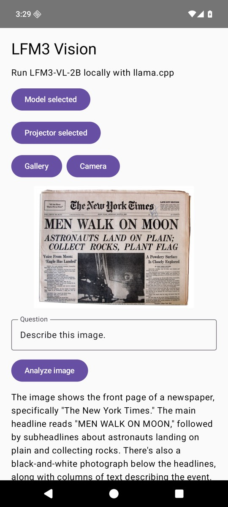

<Card title="View cookbook source" icon="github" href="https://github.com/Liquid4All/cookbook/tree/main/examples/android-vision-llamacpp">
  Browse the complete Android app, including the JNI and CMake integration.
</Card>

This tutorial builds an Android app that describes a photo and answers questions about it locally. It uses **LFM3-VL-2B** through llama.cpp's multimodal `mtmd` library. The app's Jetpack Compose screen lets the user choose a picture from the gallery or camera, enter a question, and read the model's answer. Inference stays on the device.



## Before you begin

Install Android Studio, JDK 17, Android SDK API 36, CMake 3.31.6, and NDK 28.2.13676358. Use an Android device or emulator running API 33 or newer with at least 4 GB RAM; 6 GB is more comfortable for vision inference. You need approximately 1.3 GB for the model files and another 1.3 GB when the app imports them into private storage.

Download these matching files from [LiquidAI/LFM3-VL-2B-GGUF](https://huggingface.co/LiquidAI/LFM3-VL-2B-GGUF):

| File | Purpose |
| --- | --- |
| `LFM3-VL-2B-Q4_K_M.gguf` | Quantized language model (1.10 GB) |
| `mmproj-LFM3-VL-2B-Q8_0.gguf` | Vision projector (203 MB) |

Keep the model and projector from the same repository. The app asks you to select each file with Android's document picker; it does not download model weights.

## Build and run

```bash
git clone --recurse-submodules https://github.com/Liquid4All/cookbook.git
cd cookbook/examples/android-vision-llamacpp
./gradlew :app:assembleDebug
```

Open this folder in Android Studio and run the `app` configuration on a device or emulator. You can also install the APK with `adb install -r app/build/outputs/apk/debug/app-debug.apk`.

For an emulator, copy both GGUF files into Downloads before opening the app:

```bash
adb push LFM3-VL-2B-Q4_K_M.gguf /sdcard/Download/
adb push mmproj-LFM3-VL-2B-Q8_0.gguf /sdcard/Download/
```

In the app, tap **Choose LFM3-VL model** and **Choose vision projector**. Select the corresponding files. Tap **Gallery** to choose an image, or **Camera** to take a photo. The starter question is “Describe this image.” Change it if you want to ask about a particular detail, then tap **Analyze image**.

## How it works

The [Kotlin activity](https://github.com/Liquid4All/cookbook/blob/main/examples/android-vision-llamacpp/app/src/main/java/ai/liquid/visiondemo/MainActivity.kt) uses Android's document picker for the two GGUF files and the photo picker or camera for an image. It copies user-selected files into the app's private directory, then calls a JNI function on a background thread.

The [native adapter](https://github.com/Liquid4All/cookbook/blob/main/examples/android-vision-llamacpp/app/src/main/cpp/vision.cpp) loads the language model and its vision projector. It formats a user message with llama.cpp's chat template and an image marker, creates `mtmd` image chunks, evaluates them, and samples a response. The [CMake build](https://github.com/Liquid4All/cookbook/blob/main/examples/android-vision-llamacpp/app/src/main/cpp/CMakeLists.txt) enables `LLAMA_BUILD_MTMD` and links the app's JNI library to llama.cpp and `mtmd`.

```cpp
mtmd_context *vision = mtmd_init_from_file(projector_path.c_str(), model, params);
mtmd_input_text input = {prompt.data(), prompt.size(), true, true};
const mtmd_bitmap *bitmaps[] = {image};
mtmd_tokenize(vision, chunks, &input, bitmaps, 1);
mtmd_helper_eval_chunks(vision, llama_context, chunks, 0, 0, batch_size, true, &n_past);
```

The image and prompt remain on the device. The example reloads the model for every question, so inference can take noticeably longer on an emulator than on a recent phone. See the [cookbook README](https://github.com/Liquid4All/cookbook/blob/main/examples/android-vision-llamacpp/README.md) for model checksums and the exact project setup.
