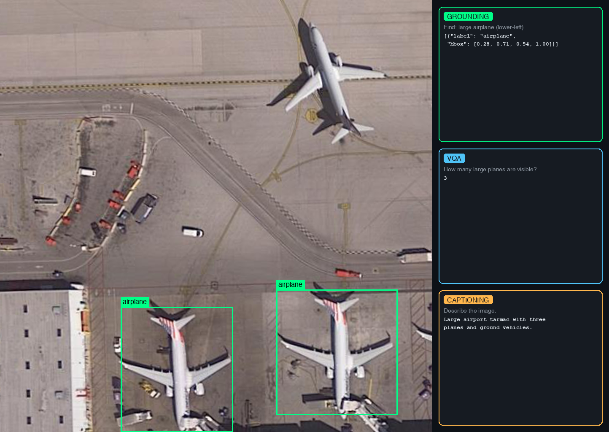
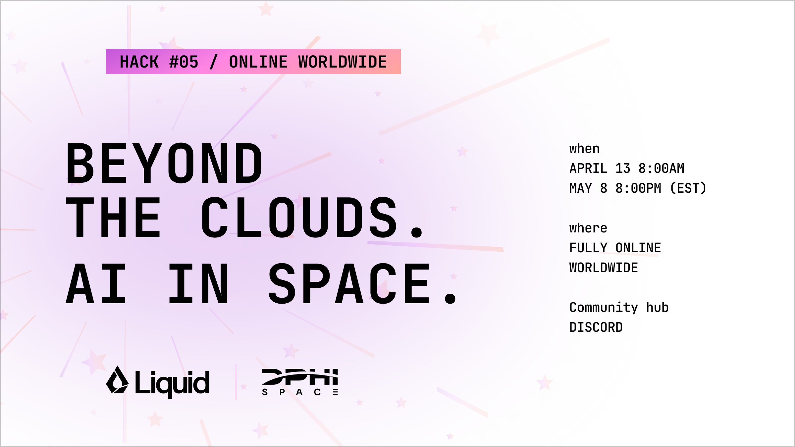

<Card title="View Source Code" icon="github" iconType="brands" href="https://github.com/Liquid4All/cookbook/tree/main/examples/satellite-vlm">
  Browse the complete example on GitHub
</Card>

Fine-tune [LiquidAI/LFM2.5-VL-450M](https://huggingface.co/LiquidAI/LFM2.5-VL-450M) on satellite imagery tasks using

- [liquid-finetune](https://github.com/Liquid4All/liquid-finetune/): Liquid AI's fine-tuning framework for LFM models.
- [Modal](https://modal.com): serverless GPU cloud for running data prep and training without managing infrastructure.
- [VRSBench](https://huggingface.co/datasets/xiang709/VRSBench) dataset (NeurIPS 2024) which supports three tasks:
  - **VQA**: answer questions about satellite images (123K QA pairs)
  - **Visual Grounding**: detect and localize objects with bounding boxes (52K references)
  - **Captioning**: generate detailed descriptions of satellite scenes (29K captions)



## Quickstart

1. **Clone, install, and authenticate:**

   Data preparation and training run on Modal. Check its current pricing before launching the full dataset run.

   ```bash
   git clone https://github.com/Liquid4All/cookbook.git
   cd cookbook/examples/satellite-vlm
   export SATELLITE_DIR="$PWD"
   uv sync
   uv run modal setup
   uv run hf auth login
   ```

   The training config already enables Weights & Biases and requests `wandb-secret`. Create that Modal secret before training:

   ```bash
   uv run modal secret create wandb-secret WANDB_API_KEY="$WANDB_API_KEY"
   ```

   To disable tracking, set `training_config.tracker: "none"` and remove `wandb-secret` from `modal.secrets` in the config.

2. **Prepare data** (~12 GB): the download and conversion run inside a Modal container, and the resulting data is pushed to a Modal volume where the fine-tuning job will pick it up.

   ```bash
   uv run python prepare_vrsbench.py --task all --modal
   ```

3. **Clone liquid-finetune and kick off fine-tuning** on an H100, checkpoints saved to the `satellite-vlm` Modal volume:

   ```bash
   git clone https://github.com/Liquid4All/liquid-finetune/
   export FINETUNE_DIR="$SATELLITE_DIR/liquid-finetune"
   uv sync --project "$FINETUNE_DIR"
   uv run --project "$FINETUNE_DIR" liquid-finetune "$SATELLITE_DIR/configs/vrsbench_multitask_modal.yaml"
   ```

## How It Works

All heavy computation runs in the cloud. The only things that run locally are the `prepare_vrsbench.py` launcher and the `liquid-finetune` CLI, both of which just submit jobs and stream logs.

1. **Data prep (Modal CPU container):** `prepare_vrsbench.py --modal` spins up a Modal container, downloads VRSBench (~12 GB) from Hugging Face, converts it to JSONL, and writes everything to a Modal volume named `satellite-vlm`.
2. **Training (Modal H100):** `liquid-finetune` submits a training job that reads data from the same volume, fine-tunes the model, and saves checkpoints back to the volume.
3. **Retrieval (local):** you pull the checkpoints from the volume to your local machine with `modal volume get`.

## Data Preparation

`prepare_vrsbench.py` downloads VRSBench from Hugging Face and converts it to the JSONL format required by liquid-finetune.

**Modal (recommended):** runs entirely in the cloud, writes directly to the `satellite-vlm` Modal volume:

```bash
uv run python prepare_vrsbench.py --task all --modal
```

**Local (for development):** single task or limited sample count for quick iteration:

```bash
uv run python prepare_vrsbench.py --task vqa --limit 500
```

Output files (written to `./data/` locally, or to the Modal volume with `--modal`):
- `vrsbench_{task}_train.jsonl`: training data
- `vrsbench_{task}_eval.jsonl`: evaluation data

## Training

Using the project paths set in the Quickstart:

```bash
uv run --project "$FINETUNE_DIR" liquid-finetune "$SATELLITE_DIR/configs/vrsbench_multitask_modal.yaml"
```

The job runs on an H100, streams logs to your terminal, and saves checkpoints to the `satellite-vlm` Modal volume under a run directory at the volume root. `/satellite-vlm` is the container mount point; do not include it in `modal volume get` paths.

The checked-in config enables `tracker: "wandb"`; use your own `wandb-secret` as described above.

## Retrieving Checkpoints

List and download checkpoints from the Modal volume:

```bash
uv run --project "$FINETUNE_DIR" modal volume ls satellite-vlm /
uv run --project "$FINETUNE_DIR" modal volume get satellite-vlm /<run-name> "$SATELLITE_DIR/outputs"
```

## Data Format

The grounding task uses JSON bounding box format with 0-1 normalized coordinates, matching the LFM VLM's pretraining format:

```
User:      Inspect the image and detect the large white ship.
           Provide result as a valid JSON:
           [{"label": str, "bbox": [x1,y1,x2,y2]}, ...].
           Coordinates must be normalized to 0-1.

Assistant: [{"label": "ship", "bbox": [0.37, 0.00, 0.80, 0.99]}]
```

VQA and captioning use standard question-answer format with no special structure.

## Evaluation

Benchmarks run automatically during training at every `eval_steps`:

- **VQA**: `short_answer` metric (case-insensitive substring match)
- **Grounding**: `grounding_iou` metric (IoU@0.5 threshold)
- **Captioning**: `BLEU` in the checked-in config

Each eval dataset can be limited (e.g., 500 samples) via the `limit` field in the YAML config for faster iteration.

`eval_on_start: true` evaluates before training; it does **not** make a training configuration evaluation-only. For a separate evaluation job, use liquid-finetune's [standalone evaluation configuration](https://github.com/Liquid4All/liquid-finetune/blob/main/job_configs/eval_standalone_example.yaml), pointing it at your checkpoint and prepared dataset. Remove benchmark `limit` values only when you intend to evaluate the full dataset.

## AI in Space Hackathon

This example was developed as a starting point for the [**AI in Space Hackathon**](https://luma.com/n9cw58h0), an online event organised in partnership between [DPhi Space](https://github.com/DPhi-Space/SimSat) and Liquid AI, open to builders from all around the globe.

Use this fine-tuning pipeline as your baseline and push it further with real satellite data.

[](https://luma.com/n9cw58h0)

<CardGroup cols={1}>

<Card title="Join our Discord" icon="discord" iconType="brands" href="https://discord.gg/DFU3WQeaYD">
  Connect with the community and ask questions about this example.
</Card>

</CardGroup>
